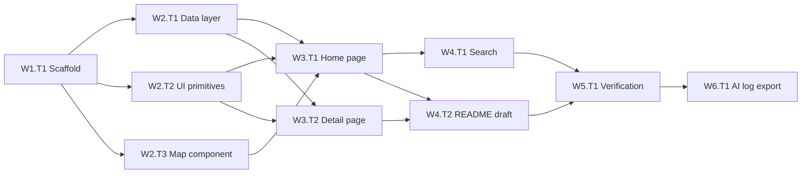

# Find a Park: WTS Breakdown and Agent Prompts

Break the Find a Park take-home (Vite + React + TS + Tailwind + react-leaflet) into small agent-sized tracks organized by Wave / Track / Sequence. Every agent reads one shared context rule and updates `progress.md`. File ownership is disjoint inside each wave, so tracks in the same wave can run concurrently.

## Project files

- `PLAN.md` (this file): waves, tracks, prompts.
- `.cursor/rules/find-a-park.mdc` (alwaysApply): the single context rule every agent reads.
- `progress.md`: lifecycle tracker with one block per track.
- `src/data/parks.json`: the sample with `images` rewritten to Wikimedia Commons URLs (created in W1.T1, see "Image sourcing").
- `ai-logs/`: unedited exports of every AI chat used for this project (created in W6.T1).

Assumptions:
- Images: hotlinked Wikimedia Commons URLs (no downloads, no keys). Exactly one park (`highland-dog-park`) keeps `"images": []` to exercise the empty case. `ParkImage` still falls back to a placeholder when a URL fails to load.
- Icons: `lucide-react` is the only icon library. Do not add `react-icons` or any other icon package.
- Tests: Vitest + React Testing Library for data helpers, search filter, and the detail page with missing fields. No Playwright. Lint/test/build run once, in W5.T1.
- No Linear issues; WTS coordinates live only in this plan since this is a standalone take-home.

## How to run this plan

1. Copy a track's prompt block exactly as written into its own new agent chat. Every block starts with the rule pointer; never paste a prompt without that first line. Tracks in the same wave can run at the same time.
2. Review each finished track and run the app locally.
3. For each accepted track, run the commit prompt in a separate chat, one at a time.
4. Start the next wave only when every track in the current wave is committed.
5. Keep every chat (planning, track, and commit chats). They are exported unedited in W6.T1.

## Wave map



- Wave 1: 1 track (sequential, must finish first).
- Wave 2: 3 tracks run concurrently.
- Wave 3: 2 tracks run concurrently.
- Wave 4: 2 tracks run concurrently.
- Wave 5: 1 track (sequential).
- Wave 6: 1 track (human-run, last; after the W5.T1 commit).

## File ownership (overlap analysis)

- **W1.T1**: `package.json`, `vite.config.ts`, `tsconfig*.json`, `index.html`, `eslint.config.js`, `.gitignore`, `src/main.tsx`, `src/App.tsx`, `src/index.css`, `src/types/park.ts`, `src/data/parks.json`, `src/test/setup.ts`, placeholder `src/pages/HomePage.tsx` + `src/pages/ParkDetailPage.tsx`.
- **W2.T1**: `src/data/parks.ts`, `src/data/parks.test.ts`, `src/lib/format.ts`.
- **W2.T2**: `src/components/ui/*` (`StarRating`, `ParkImage`, `BackLink`, `InfoRow`, `AmenityChip`, `Placeholder`), `src/lib/amenities.ts`.
- **W2.T3**: `src/components/map/ParkMap.tsx`, `src/components/map/ParkPopup.tsx`.
- **W3.T1**: `src/pages/HomePage.tsx`, `src/components/park-list/*`.
- **W3.T2**: `src/pages/ParkDetailPage.tsx`, `src/components/park-detail/*`, `src/pages/ParkDetailPage.test.tsx`.
- **W4.T1**: `src/lib/filterParks.ts`, `src/lib/filterParks.test.ts`, `src/components/search/SearchInput.tsx`, `src/pages/HomePage.tsx`, `src/components/park-list/ParkListPanel.tsx`.
- **W4.T2**: `README.md` only.
- **W5.T1**: any file (fixes only), `README.md` finalize.
- **W6.T1**: `ai-logs/*`, the "AI conversation logs" section of `README.md`.
- **Every track**: its own block in `progress.md` only.

Result: no file is owned by two tracks in the same wave. `App.tsx` routes are registered once in W1, so later tracks never touch it. W4.T1 edits `HomePage.tsx` only after W3.T1 has finished.

Runtime-surface check: each route has exactly one writer (W3.T1 owns `/`, W3.T2 owns `/park/:id`). The home-page map region is written by W3.T1 and then by W4.T1 in a later wave. Search wins by design: it feeds filtered parks into the same `ParkMap` and list. No unresolved shared surfaces.

## Image sourcing (applied in W1.T1)

Only Prospect Park is a real park. The others are fictional, so each uses a real Wikimedia Commons photo that matches the park's character. Use the `https://upload.wikimedia.org/wikipedia/commons/thumb/...` 1280px thumbnail form and drop any `utm_*` query string.

- `prospect-park`: `Prospect_Park_New_York_October_2015_003.jpg` (real park, CC BY-SA 4.0)
- `riverside-commons`: `Riverside_Park_02.jpg`, `Riverside_Park_Pier_I.jpg` (Riverside Park, CC BY-SA 3.0 / 4.0)
- `central-plaza-green`: `Bryant_Park_jeh.JPG` (public domain)
- `old-mill-botanical-garden`: `Brooklyn_Botanic_Garden_New_York_May_2015_panorama_2.jpg`, `Bluebells_in_the_Brooklyn_Botanic_Garden_(42915p).jpg` (CC BY-SA 3.0 / 4.0)
- `willow-creek-wetlands`: `Salt_Marsh_in_Gerritsen_Beach_(10813p).jpg` (CC BY-SA 4.0)
- `hillcrest-skate-park`: `Brooklyn_Banks-_the_skatepark_that_wasn't_supposed_to_be_a_skatepark_(4264784146).jpg` (CC BY 2.0)
- `veterans-memorial-field`: `Flushing_Meadows_Meadow_Lake_td_(2018-05-26)_25_-_Baseball_Field_13.jpg` (CC BY-SA 4.0)
- `sunset-playground`: `Playground_2947.jpg` (CC BY-SA 4.0)
- `cedar-hill-nature-preserve`: search ("deciduous forest boardwalk trail")
- `east-ridge-trailhead`: search ("ridge trail overlook New York")
- `lakeshore-point`: search ("fishing pier waterfront park")
- `highland-dog-park`: `[]` (intentional empty case; the placeholder renders)

## Agent prompts

Each block below is a complete prompt. Copy the whole block; the first line always points the agent at the rule.

### W1.T1 Scaffold (run alone)

````text
Read `.cursor/rules/find-a-park.mdc` first and follow it for this entire task. Then read `PLAN.md` and `progress.md`.
You are track W1.T1 Scaffold. Only edit files listed for W1.T1 in the PLAN.md file ownership list, plus your own block in progress.md. Mark your block IN PROGRESS now and DONE with notes when finished. Do not run lint, tests, or build. Do not commit.

Create a Vite React-TS app in the repo root (keep the existing PLAN.md, progress.md, assets/, and .cursor/). Install `tailwindcss @tailwindcss/vite react-router-dom react-leaflet leaflet lucide-react` and dev deps `@types/leaflet vitest @testing-library/react @testing-library/jest-dom @testing-library/user-event jsdom`. Configure Vitest (jsdom, `src/test/setup.ts`). Configure Tailwind v4 tokens from the rule's design system section in `src/index.css`. Add `src/types/park.ts` with every key nullable:

```ts
export type ParkLocation = { lat: number | null; lng: number | null; address: string | null };
export type Park = {
  id: string | null; name: string | null; description: string | null;
  location: ParkLocation | null; amenities: string[] | null; hours: string | null;
  images: string[] | null; acreage: number | null; rating: number | null;
};
```

Add `.gitignore` entries for node_modules and dist (keep any existing entries). Copy `assets/parks.sample.json` (leave the original untouched) to `src/data/parks.json` and replace every `images` array with the Wikimedia URLs from "Image sourcing" in PLAN.md (keep `highland-dog-park` as `[]`; change no other field). For the three rows marked "search", query the Commons API, pick a CC BY / CC BY-SA / public-domain photo, and verify each URL returns HTTP 200 with `curl -sI`. Record file name, author, license, and URL for each image in your progress.md block so W4.T2 can credit them. In `src/App.tsx` register routes `/` and `/park/:id` with a catch-all, using placeholder pages. Add npm scripts `lint`, `test`, `build`. Set "Current wave" in progress.md to 2 when done.
````

### W2.T1 Data layer (concurrent with W2.T2, W2.T3)

```text
Read `.cursor/rules/find-a-park.mdc` first and follow it for this entire task. Then read `PLAN.md` and `progress.md`.
You are track W2.T1 Data layer. Only edit files listed for W2.T1 in the PLAN.md file ownership list, plus your own block in progress.md. Mark your block IN PROGRESS now and DONE with notes when finished. Do not run lint, tests, or build. Do not commit.

Implement `src/data/parks.ts`:
- `normalizeParks(raw: unknown): Park[]` is the single entry point for park data. It accepts anything, returns [] when the input is not an array, and maps each entry to a Park with every key present. Missing, undefined, or wrongly typed values become null (for example a string rating becomes null, lat: "abc" becomes null). Strings are trimmed and empty strings become null. Arrays keep only non-empty strings. A missing location becomes null. Entries with a null id are dropped, because they cannot have a /park/:id route.
- Normalize once at app startup: the data is static, so parks.ts computes `const PARKS = normalizeParks(rawJson)` (sorted by name, null names last) a single time at module load. getParks() returns PARKS; components must not call normalizeParks themselves.
- `getParkById(id)` returns `Park | null`.

Parks with null lat/lng still appear in the list but are skipped by the map. Implement `src/lib/format.ts`: formatAcreage, formatRating ("4.4 / 5" or "No rating yet"), hasAddress. Write `src/data/parks.test.ts` covering each known data gap (highland-dog-park has images: [] and location.address: null; Old Mill has description: null; Cedar Hill has rating: null). Also test normalizeParks on non-array input, an entry missing every key, wrong types, and an entry without an id (dropped).
```

### W2.T2 UI primitives (concurrent)

```text
Read `.cursor/rules/find-a-park.mdc` first and follow it for this entire task. Then read `PLAN.md` and `progress.md`.
You are track W2.T2 UI primitives. Only edit files listed for W2.T2 in the PLAN.md file ownership list, plus your own block in progress.md. Mark your block IN PROGRESS now and DONE with notes when finished. Do not run lint, tests, or build. Do not commit.

Build presentational components in `src/components/ui/` that take primitive props only (no data imports):
- StarRating: half stars, aria-label "Rated 4.4 out of 5", renders nothing if no rating.
- ParkImage: falls back to Placeholder (mountain illustration) on empty src or onError.
- BackLink: white pill with chevron, router Link.
- InfoRow: label + value.
- AmenityChip: icon + label.
All icons come from lucide-react (for example ChevronLeft, Star, StarHalf, Mountain, Bike, Anchor, Dog, Toilet, TreePine). Add `src/lib/amenities.ts` mapping amenity slugs to label + lucide icon (fallback icon MapPin), with a title-cased fallback label for unknown slugs. All interactive elements get the focus ring token.
```

### W2.T3 Map component (concurrent)

```text
Read `.cursor/rules/find-a-park.mdc` first and follow it for this entire task. Then read `PLAN.md` and `progress.md`.
You are track W2.T3 Map component. Only edit files listed for W2.T3 in the PLAN.md file ownership list, plus your own block in progress.md. Mark your block IN PROGRESS now and DONE with notes when finished. Do not run lint, tests, or build. Do not commit.

Build `src/components/map/ParkMap.tsx` with react-leaflet: props `parks: Park[]`, `className?`. OSM tile layer with attribution. Render CircleMarker in the primary color (no default icon asset issues), skipping parks whose location, lat, or lng is null. Fit bounds to the parks, with a sensible NYC fallback center when the list is empty. On marker click, open `src/components/map/ParkPopup.tsx`, which shows the name, the address if present, and a "View details" Link to /park/:id. Import leaflet/dist/leaflet.css. Must work with no geolocation. Give the map container an aria-label.
```

### W3.T1 Home page (concurrent with W3.T2)

```text
Read `.cursor/rules/find-a-park.mdc` first and follow it for this entire task. Then read `PLAN.md` and `progress.md`.
You are track W3.T1 Home page. Only edit files listed for W3.T1 in the PLAN.md file ownership list, plus your own block in progress.md. Mark your block IN PROGRESS now and DONE with notes when finished. Do not run lint, tests, or build. Do not commit.

Build `src/pages/HomePage.tsx` and `src/components/park-list/` (ParkList, ParkListItem, ParkListPanel). Data comes from getParks(). Each list item is a router Link with a thumbnail (ParkImage), name, address (omitted if missing), and chevron, plus a visible focus ring.
- Mobile (below md): header "Find a Park", list, and an "Open map" button that toggles a full-screen ParkMap with a "Show list" button.
- Desktop (md and up): full-viewport ParkMap with a floating rounded left panel containing the list (scrollable).
Reserve an empty slot above the list for search (filled in W4).
```

### W3.T2 Detail page (concurrent)

```text
Read `.cursor/rules/find-a-park.mdc` first and follow it for this entire task. Then read `PLAN.md` and `progress.md`.
You are track W3.T2 Detail page. Only edit files listed for W3.T2 in the PLAN.md file ownership list, plus your own block in progress.md. Mark your block IN PROGRESS now and DONE with notes when finished. Do not run lint, tests, or build. Do not commit.

Build `src/pages/ParkDetailPage.tsx` and `src/components/park-detail/` (ParkHero, ParkInfoList, AmenityGrid, PhotoGallery). Use getParkById; if it returns null, show "Park not found" with a link home.
- Mobile: full-bleed hero, BackLink overlaid, and a content card with rounded-t-3xl -mt-6 and a drag-handle bar.
- Desktop: centered max-w-3xl with a rounded hero.
Show the name (h1), address, StarRating, description or "No description available", info rows (Address, Hours, Size, Rating), amenity grid, and photos (hidden if none). Set document.title. Write `src/pages/ParkDetailPage.test.tsx` for Highland Dog Park (no images, no address), Cedar Hill (no rating), and Old Mill (no description), plus an image whose URL fails (placeholder shown).
```

### W4.T1 Search (concurrent with W4.T2)

```text
Read `.cursor/rules/find-a-park.mdc` first and follow it for this entire task. Then read `PLAN.md` and `progress.md`.
You are track W4.T1 Search. Only edit files listed for W4.T1 in the PLAN.md file ownership list, plus your own block in progress.md. Mark your block IN PROGRESS now and DONE with notes when finished. Do not run lint, tests, or build. Do not commit.

Add `src/lib/filterParks.ts` with filterParks(parks, query): case-insensitive match on name, address, and amenity labels; trimmed; empty query returns all. Add `src/lib/filterParks.test.ts`. Build `src/components/search/SearchInput.tsx` (labelled, search icon, clear button, type="search"). In HomePage, keep the query in the URL (?q=) so going back from details preserves it. Feed the filtered parks to both the list and ParkMap. Show the count "Find a Park (4 of 12)" while filtering, and an empty state "No parks match" with a clear action.
```

### W4.T2 README draft (concurrent)

```text
Read `.cursor/rules/find-a-park.mdc` first and follow it for this entire task. Then read `PLAN.md` and `progress.md`.
You are track W4.T2 README draft. Only edit README.md, plus your own block in progress.md. Mark your block IN PROGRESS now and DONE with notes when finished. Do not run lint, tests, or build. Do not commit.

Draft README.md per the brief:
- Run instructions, what works, what was left out.
- Key decisions: stack, no API keys, CircleMarkers, URL search state, lucide-react icons, normalize-once data layer.
- "Data changes": sample images replaced with hotlinked Wikimedia Commons photos, fictional parks use representative stand-in photos, highland-dog-park intentionally left without images.
- "Image credits": file, author, license, link, from the W1.T1 notes in progress.md.
- Known issues (hotlinked images depend on Wikimedia availability), how it was checked, time spent, next steps before public use.
- "AI conversation logs": explain that every chat used for this project is in ai-logs/, unedited, and that the work was split into Wave/Track prompts per PLAN.md. Leave a placeholder list for W6.T1 to fill with each file name and the track it covers.
- Leave an empty "Verification results" section for W5.T1.
```

### W5.T1 Verification pass (run alone)

```text
Read `.cursor/rules/find-a-park.mdc` first and follow it for this entire task. Then read `PLAN.md` and `progress.md`.
You are track W5.T1 Verification pass. You may edit any file, but only to fix problems, plus your own block in progress.md. Mark your block IN PROGRESS now and DONE with notes when finished. Do not commit.

This is the only lint/test/build pass in the project. Run `npm run lint && npm test && npm run build` and fix every failure. Manually check at 375px and 1280px widths. Use only the keyboard to tab from the list to a detail page and back, confirming the focus ring is visible. Check every park's detail page for crashes or invented data. Check that search filters both the list and the markers. Fix issues with minimal edits, record findings in the README "Verification results" section, and set "Current wave" in progress.md to 6.
```

### W6.T1 AI log export (human-run, last)

This track is done by you, not an agent, because exporting chats happens in the Cursor UI. Do it after the W5.T1 commit so every chat is included.

1. Create `ai-logs/` in the repo root.
2. Export every chat used for this project, unedited, in the order they happened: this planning chat, every track chat, and every commit chat. Use the chat's export option, or copy the raw transcript files from `~/.cursor/projects/Users-nicknavarro-Learn-find-parks-poc/agent-transcripts/`.
3. Name files by order and purpose, for example `00-planning.md`, `01-W1.T1-scaffold.md`, `02-W1.T1-commit.md`.
4. Optionally run this prompt in a new chat to fill in the README index (that chat must be exported too):

```text
Read `.cursor/rules/find-a-park.mdc` first and follow it for this entire task. Then read `PLAN.md` and `progress.md`.
You are track W6.T1 AI log export. Do not open, edit, rename, or summarize any file inside ai-logs/. Only edit the "AI conversation logs" section of README.md and your own block in progress.md.

List every file in ai-logs/ in the README "AI conversation logs" section with one line each describing which track or step it covers (use the file names and PLAN.md, not the file contents). Set "Current wave" in progress.md to complete.
```

5. Commit with `[W6.T1] Add unredacted AI conversation logs`, then zip the repo for submission.

## Commit after each accepted track

Once a track's agent marks its block DONE and you have reviewed and accepted its files, run the commit prompt for that track as its own separate prompt in a new chat. Build agents never commit.

- **Message format:** `[W#.T#] What was done`, for example `[W2.T1] Add normalizeParks and park data helpers with tests`.
- **One commit per track.** Run commit prompts one at a time, never concurrently, because concurrent tracks share one git index.
- **Stage only that track's owned files.** `progress.md` is shared, so stage it with the last track commit of each wave. W1.T1's commit also stages `PLAN.md`, `.cursor/rules/find-a-park.mdc`, and `assets/parks.sample.json`.
- **Reject path:** if you do not accept the files, do not commit. Re-run or amend the track prompt first.

Commit prompt (fill in the track ID and summary):

```text
Read `.cursor/rules/find-a-park.mdc` first and follow it for this entire task. Then read `PLAN.md` and `progress.md`.
Track {W#.T#} has been reviewed and accepted. Do not run lint, tests, or build. Run `git status`, then stage only the files listed for {W#.T#} in the PLAN.md file ownership list (plus progress.md if this is the last track of the wave). Show me `git diff --cached --stat`, then commit with the message `[{W#.T#}] {what was done}` (one line, imperative, under 72 characters). Do not push. Add the commit hash to the {W#.T#} block in progress.md (leave that edit uncommitted; it rides along with the next commit).
```

Order per wave: run the track prompts (concurrently where allowed), review each track, then run commit prompts one by one, then start the next wave.

## Rollback

Each track is small enough to revert by discarding its owned files (`git checkout -- <files>`). W1 is the only track whose rollback blocks everything else.
